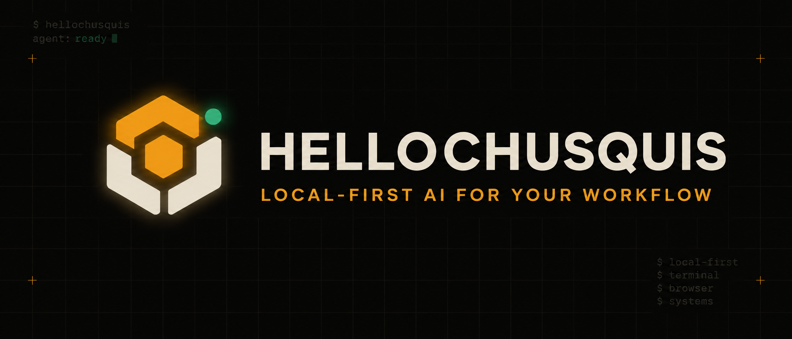
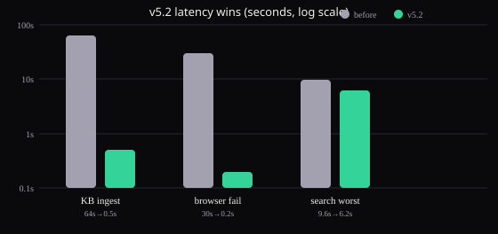

# HelloChusquis

<p align="center">
  
</p>

> **A local-first AI agent for the terminal, the browser, and the systems around your work.**

HelloChusquis brings conversation, tools, memory, web access, code execution, and integrations into one developer-controlled workspace. Run it interactively in the terminal, expose it through the authenticated web interface, or use the REST API from your own workflows.

[](LICENSE)
[](pyproject.toml)
[](tests/)
[](https://github.com/aminoy77/HelloChusquis)

<p align="center">
  <a href="github-social-preview.png">View the GitHub social preview</a>
</p>

## Why HelloChusquis?

Most AI tools make you leave the place where the work happens. HelloChusquis keeps the agent close to your terminal and gives it a controlled set of tools for doing useful work: inspect a codebase, search the web, run bounded code, manage files, remember context, and connect to external services.

It is designed for people who want **automation with visibility**. High-impact operations can pause for approval, HTTP sessions are isolated, credentials are protected, and the public web/API surfaces expose stable readiness and error contracts.

## Quick start

### 1. Install

```bash
python -m pip install hellochusquis
```

### 2. Configure a provider

The setup wizard stores provider configuration under `~/.hellochusquis`.

```bash
hellochusquis config
```

For a fast OpenRouter setup:

```bash
hellochusquis --quick
```

### 3. Start chatting

```bash
hellochusquis
```

Then ask for something concrete:

```text
Search the web for the latest Python release and summarize what changed.
```

> HelloChusquis can run with different provider configurations. Keep API keys in the local setup store or environment variables; never commit them to the repository.

## Three ways to use it

| Surface | Start command | Best for |
| --- | --- | --- |
| **Terminal** | `hellochusquis` | Interactive work, planning, tools, and fast feedback |
| **Web interface** | `hellochusquis web` | A visual chat workspace with streaming, voice, themes, and export |
| **REST API** | `hellochusquis api --port 8080` | Applications, automation, isolated sessions, and service integrations |
| **Telegram** | `hellochusquis telegram --allow <chat-id>` | Chat from Telegram, allowlisted chats only |

## What it can do

### Work beside your code

Use the built-in shell, code, file, browser, and web-search tools from one conversation. Multi-step tasks can be planned explicitly with `/plan`, while tool calls remain visible in the response stream.

### Connect to the services you already use

The `tools/` package contains integrations for services such as GitHub, Slack, Discord, Docker, Notion, AWS, Gmail, Jira, PostgreSQL, MongoDB, Stripe, Twilio, Supabase, Vercel, HubSpot, Shopify, Mailchimp, Airtable, Linear, Kubernetes, and Terraform. Provider-specific SDKs are kept optional where possible.

### Keep context useful

Conversation history is bounded and can be compressed. SQLite-backed memory stores sessions, summaries, learnings, and search indexes locally so the agent can retain useful context without turning every prompt into a transcript dump.

Every turn is automatically saved and searchable: before answering, the agent recalls the most relevant past turns and facts into context. Say `remember <fact>` to pin something explicitly and `forget <key>` to remove matching memories — both work mid-chat without calling the model.

### Reference knowledge (MDknowledge)

The `MDknowledge/` folder ships 1200+ curated markdown files (~9900 facts: programming idioms, capitals, elements, math, science, history) that are ingested into memory at startup and recalled per turn as reference context. Add your own under the same tree, or override any file in `~/.hellochusquis/knowledge/<same/path.md>`. One fact per `- bullet`; fenced code blocks are skipped. Measured on a 35-question factual probe with a local 3B model: 86% → **100%** accuracy (retrieval coverage 97% vs 0% without it). Smaller models gain the most; reasoning-heavy tasks gain less.




### Use the web and API safely

The web interface and REST API support streaming responses, readiness checks, request limits, isolated HTTP sessions, persistent approval audit records, and principal-based roles. Sessions are scoped to their caller rather than shared globally.

## Web interface

Start the authenticated web interface locally:

```bash
hellochusquis web
```

Open [http://localhost:7272](http://localhost:7272). On first launch, the server creates a local access key. You can inspect it with:

```bash
cat ~/.hellochusquis/api_key.txt
```

Or provide one explicitly before starting:

```bash
HELLOCHUSQUIS_API_KEY=replace-me hellochusquis web
```

Authentication is enabled by default. Only disable it for an intentionally isolated local session:

```bash
HELLOCHUSQUIS_AUTH=0 hellochusquis web
```

The web workspace includes provider/model selection, streaming chat, voice input controls, conversation export, feedback, appearance settings, command palette actions, approvals, and a landing page that links back to the application.

## Telegram

Chat with the same agent from Telegram. Create a bot with [@BotFather](https://t.me/BotFather), then start the bridge with your chat ID allowlisted (find it via [@userinfobot](https://t.me/userinfobot)):

```bash
hellochusquis telegram --token <bot-token> --allow <your-chat-id>
```

Or via environment (same values as flags):

```bash
HELLOCHUSQUIS_TELEGRAM_TOKEN=... HELLOCHUSQUIS_TELEGRAM_ALLOW=123,456 hellochusquis telegram
```

Only allowlisted chats get replies; everyone else is ignored. Each chat keeps its own conversation. No new dependencies — long-polling over the standard library.

## REST API

Start the API:

```bash
hellochusquis api --host 127.0.0.1 --port 8080
export HC_TOKEN="$(cat ~/.hellochusquis/api_key.txt)"
```

Send a regular request with an explicit isolated session:

```bash
curl -X POST http://localhost:8080/chat \
  -H "Authorization: Bearer $HC_TOKEN" \
  -H "X-HelloChusquis-Session: local-demo" \
  -H "Content-Type: application/json" \
  -d '{"message":"Explain this repository in three steps.","stream":false}'
```

Request a streaming response:

```bash
curl -N -X POST http://localhost:8080/chat \
  -H "Authorization: Bearer $HC_TOKEN" \
  -H "X-HelloChusquis-Session: local-demo" \
  -H "Content-Type: application/json" \
  -d '{"message":"Inspect the tests and summarize the riskiest area.","stream":true}'
```

Check health and readiness:

```bash
curl http://localhost:8080/health
curl http://localhost:8080/health/ready
```

## Approvals, roles, and audit

HTTP sessions use a local approval gate for high-impact actions. Shell execution, file mutation, external writes, browser submissions, MCP calls, and similar operations can require a human decision before dispatch.

Approval requests are session-local, short-lived, single-use, and shown to clients with credential-like fields redacted. Approval requests and decisions are retained in the persistent audit store for later inspection.

Named principals can be managed from the CLI:

```bash
hellochusquis users add dana --role operator
hellochusquis users list
hellochusquis users revoke dana
```

| Role | Access |
| --- | --- |
| `viewer` | Read history, approvals, and audit state |
| `operator` | Viewer access plus chat, approvals, and mutating tools through the approval gate |
| `owner` | Operator access plus runtime reload, provider updates, and user management |

The deployment-wide API key acts as an owner key. Named tokens are stored as hashes in `~/.hellochusquis/identity.db` and are shown once when created.

Inspect pending approvals or redacted audit records:

```bash
curl http://localhost:8080/approvals \
  -H "Authorization: Bearer $HC_TOKEN" \
  -H "X-HelloChusquis-Session: local-demo"

curl 'http://localhost:8080/audit?limit=50' \
  -H "Authorization: Bearer $HC_TOKEN" \
  -H "X-HelloChusquis-Session: local-demo"
```

Approve one pending action:

```bash
curl -X POST http://localhost:8080/approvals/APPROVAL_ID \
  -H "Authorization: Bearer $HC_TOKEN" \
  -H "X-HelloChusquis-Session: local-demo" \
  -H "Content-Type: application/json" \
  -d '{"approve":true}'
```

## Configuration and optional extras

Core runtime dependencies are installed with the package. Optional extras add SDKs for specific integrations:

```bash
python -m pip install 'hellochusquis[aws]'    # S3-compatible integrations
python -m pip install 'hellochusquis[voice]'  # speech recognition
python -m pip install 'hellochusquis[watch]'  # filesystem watching
python -m pip install 'hellochusquis[dev]'    # pytest and ruff
```

Common environment variables:

| Variable | Purpose |
| --- | --- |
| `HELLOCHUSQUIS_API_KEY` | Deployment-wide owner key for web/API clients |
| `HELLOCHUSQUIS_IDENTITY_DB` | Override the identity database path |
| `HELLOCHUSQUIS_AUTH=0` | Disable web auth only for isolated local development |
| `HELLOCHUSQUIS_UNSAFE_MODE=1` | Skip safety checks; use only in a controlled environment |
| `HELLOCHUSQUIS_PROFILE=aggressive` | Skip safety reviews; use only when you understand the trade-off |
| `DEBUG=1` | Enable debug logging |

Configuration files and local stores are kept under `~/.hellochusquis` by default. The runtime repairs managed directory/file permissions when opening protected local stores.

## Command reference

```text
hellochusquis                         Start interactive chat
hellochusquis web                     Start the web interface on port 7272
hellochusquis api --port 8080         Start the REST API
hellochusquis config                   Open the setup wizard
hellochusquis config --show            Display current configuration
hellochusquis config --api-keys        Edit provider keys
hellochusquis config --providers       Edit provider selection
hellochusquis users list               List principals
hellochusquis users add NAME --role ROLE
hellochusquis users revoke NAME        Revoke a principal
hellochusquis doctor --contracts       Run offline integration contract checks
```

Useful in-chat commands:

```text
/help                                  Show available commands
/status                                Show provider status
/clear                                 Clear the current conversation
/plan <task>                           Force a multi-step plan
exit                                   Leave the terminal session
```

## Architecture at a glance

```text
main.py / cli.py              CLI entry points and interactive loop
core/agent.py                 Orchestration, planning, and tool dispatch
core/provider.py              Provider pool and fallback behavior
core/history.py               Bounded context and compression
core/db_memory.py             SQLite sessions, summaries, and memory
core/runtime.py               Recoverable startup and isolated HTTP sessions
core/approvals.py             Session-local, replay-safe human approvals
core/integration_contracts.py Offline integration diagnostics
web/server.py                 Authenticated FastAPI web interface
api/main.py                   Authenticated REST API and rate limits
tools/                        Service integrations and built-in tool modules
ui/                           Terminal UI and interactive presentation
```

## Development

Clone the repository and create a virtual environment:

```bash
git clone https://github.com/aminoy77/HelloChusquis.git
cd HelloChusquis
python -m venv .venv
source .venv/bin/activate
python -m pip install -e '.[dev]'
```

Run the full test suite:

```bash
python -m unittest discover tests -q
```

Run lint checks:

```bash
ruff check .
```

Run offline integration diagnostics without provider credentials or third-party calls:

```bash
hellochusquis doctor --contracts
```

When contributing, keep changes focused, add regression coverage for behavior changes, and avoid committing local keys, databases, caches, or generated artifacts.

## Project links

- [Landing page](https://hellochusquis.dev)
- [Source code](https://github.com/aminoy77/HelloChusquis)
- [Issue tracker](https://github.com/aminoy77/HelloChusquis/issues)
- [Changelog](CHANGELOG.md)
- [Web interface source](web/index.html)

## License

HelloChusquis is released under the [MIT License](LICENSE).
